# Лабораторная работа № 1. Обзор Google Cloud и исследование основных сервисов

**Университет:** ИТМО  
**Факультет:** ФТМИ  
**Дисциплина:** Облачные платформы как основа технологического предпринимательства  
**Учебный год:** 2026/2027  
**Группа:** указать группу  
**Автор:** Дьячкова Ангелина  
**Лабораторная работа:** № 1  
**Дата начала:** 03.11.2026  
**Дата защиты:** указывается после защиты

## Цель работы

Познакомиться с возможностями Google Cloud, создать виртуальную машину и сервисный аккаунт, проверить доступ к объектному хранилищу при разных ролях IAM.

## Задачи

1. Создать сервисный аккаунт с ролью Storage Admin.
2. Создать виртуальную машину типа e2-micro в режиме Spot.
3. Найти учебный бакет и скопировать три файла на виртуальную машину.
4. Изменить роль сервисного аккаунта на Compute Viewer и повторить копирование.
5. Проанализировать результат и удалить созданные ресурсы.

## Ход работы

Работа проводилась в учебном проекте **cloud-platforms-as-the-basis**.

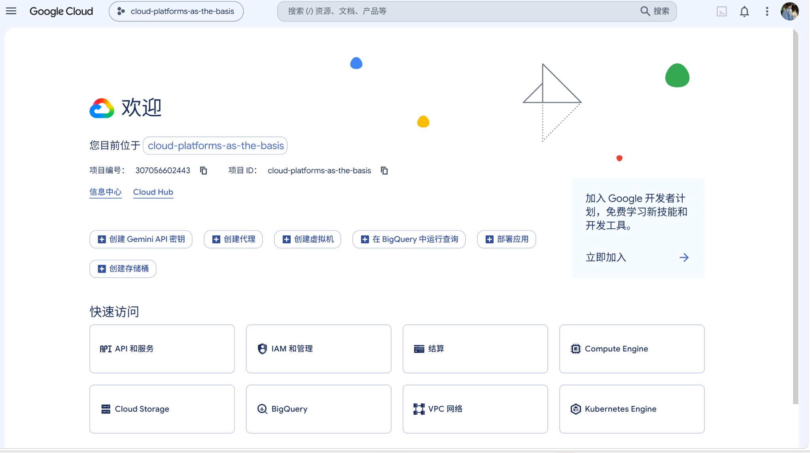

*Рисунок 1 — Учебный проект Google Cloud.*

### 1. Создание сервисного аккаунта

В разделе **IAM & Admin → Service Accounts** создан сервисный аккаунт `adiachkova-sa-lab1`. При создании ему назначена роль **Storage Admin**, предоставляющая права управления Cloud Storage в пределах действия назначенной роли.

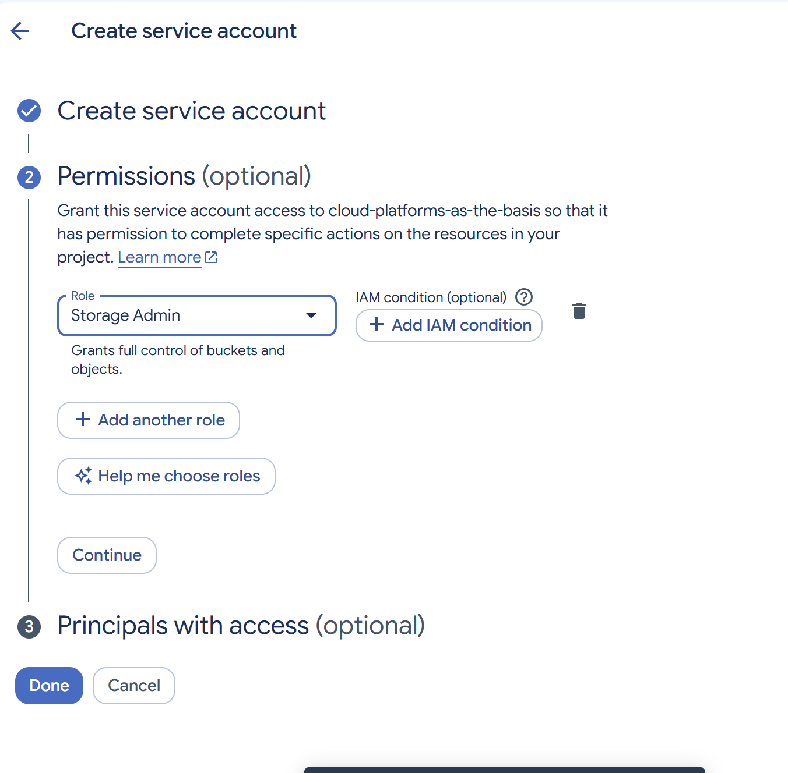

*Рисунок 2 — Назначение роли Storage Admin.*

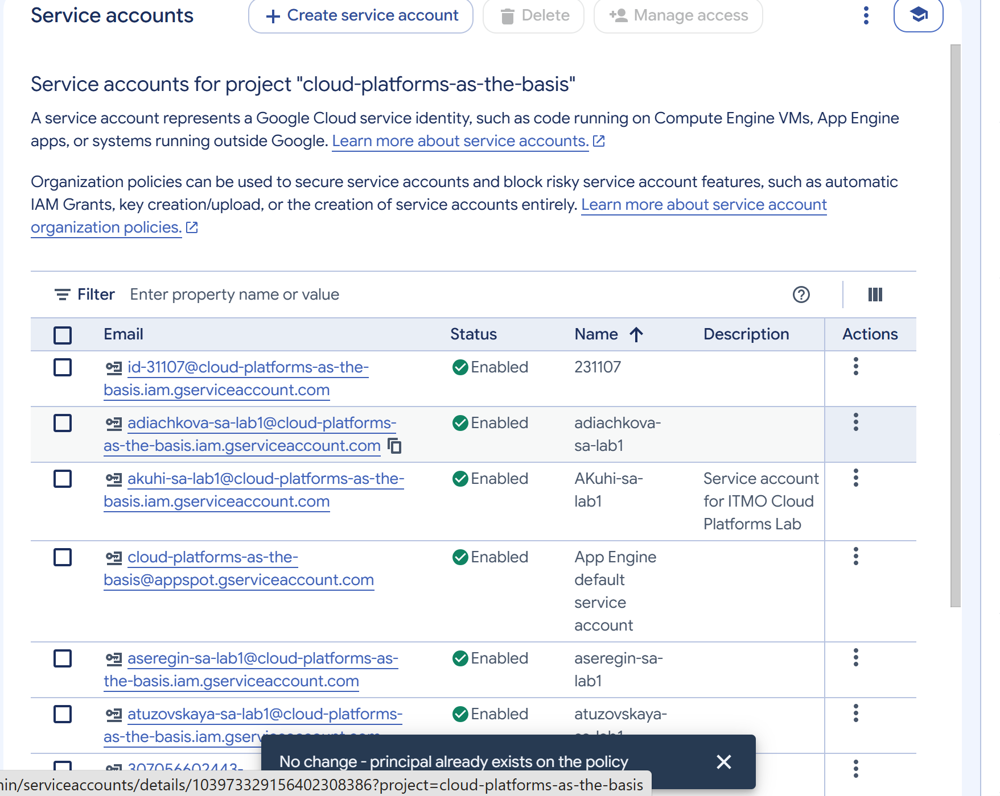

*Рисунок 3 — Сервисный аккаунт в общем списке проекта.*

### 2. Создание виртуальной машины

В разделе **Compute Engine → VM instances** создана виртуальная машина `adiachkova-vm-lab1`. Выбран тип машины **e2-micro** и модель предоставления **Spot**. Машина создана в зоне `us-central1-b`; операционная система — Debian GNU/Linux 13.

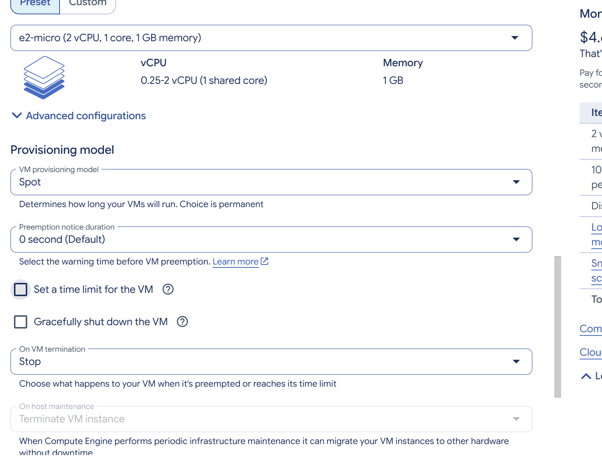

*Рисунок 4 — Тип виртуальной машины и режим Spot.*

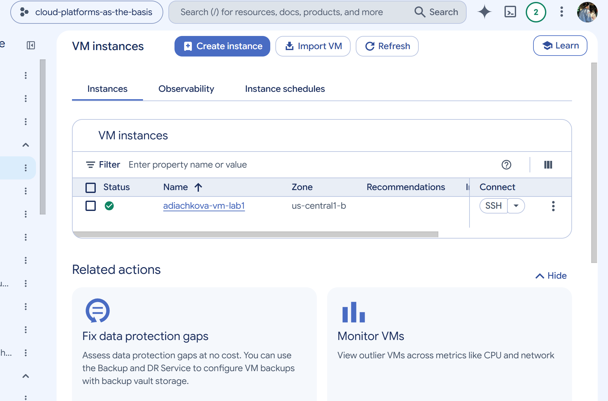

*Рисунок 5 — Запущенная виртуальная машина.*

### 3. Подключение и работа с Cloud Storage

К виртуальной машине выполнено подключение через кнопку **SSH** в браузере.

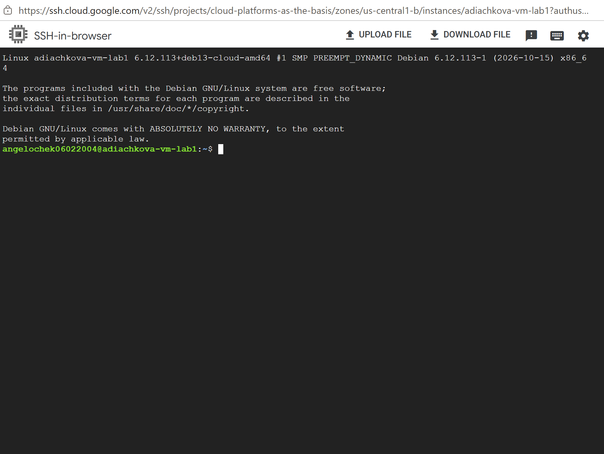

*Рисунок 6 — Подключение к виртуальной машине через SSH.*

Для просмотра содержимого бакета выполнена команда:

```bash
gcloud storage ls gs://lab1-bucket-itmo/
```

В бакете обнаружены три объекта: `pic1.jpg`, `pic2.jpg` и `pic3.jpeg`.

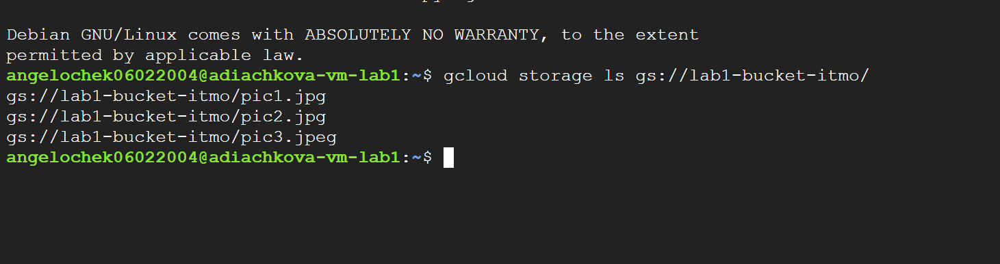

*Рисунок 7 — Список файлов в бакете.*

Создана локальная папка на виртуальной машине, после чего файлы скопированы из Cloud Storage:

```bash
mkdir -p ~/lab1
gcloud storage cp gs://lab1-bucket-itmo/pic1.jpg gs://lab1-bucket-itmo/pic2.jpg gs://lab1-bucket-itmo/pic3.jpeg ~/lab1/
ls -lah ~/lab1
```

Копирование завершилось сообщением `Completed files 3/3`. Команда `ls -lah` показала три файла в папке `lab1` на виртуальной машине.

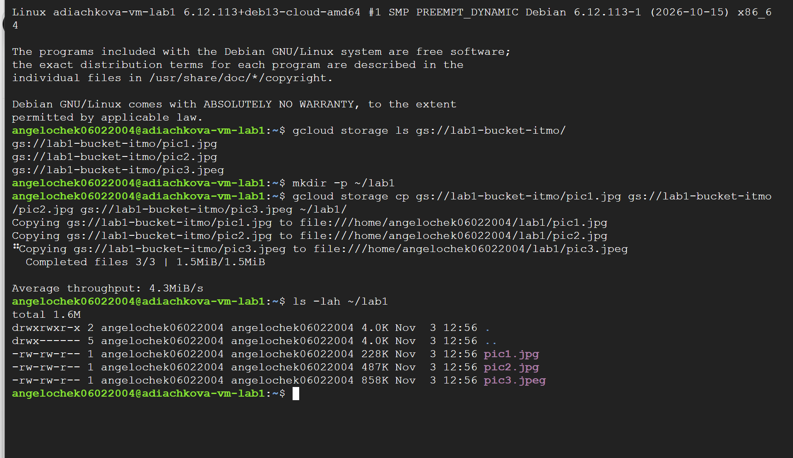

*Рисунок 8 — Копирование файлов и проверка их наличия командой ls -lah.*

### 4. Изменение роли и повторное копирование

В разделе **IAM & Admin → IAM** роль сервисного аккаунта заменена с **Storage Admin** на **Compute Viewer**.

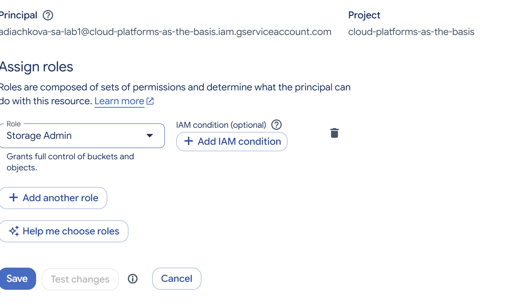

*Рисунок 9 — Роль Storage Admin до изменения.*


*Рисунок 10 — Роль Compute Viewer после изменения.*

Для повторной проверки создана другая локальная папка и выполнена команда копирования:

```bash
mkdir -p ~/lab1-test2
gcloud storage cp gs://lab1-bucket-itmo/pic1.jpg gs://lab1-bucket-itmo/pic2.jpg gs://lab1-bucket-itmo/pic3.jpeg ~/lab1-test2/
```

Все три файла снова успешно скопированы. Проверка `gcloud auth list` показала, что активен сервисный аккаунт `adiachkova-sa-lab1`.

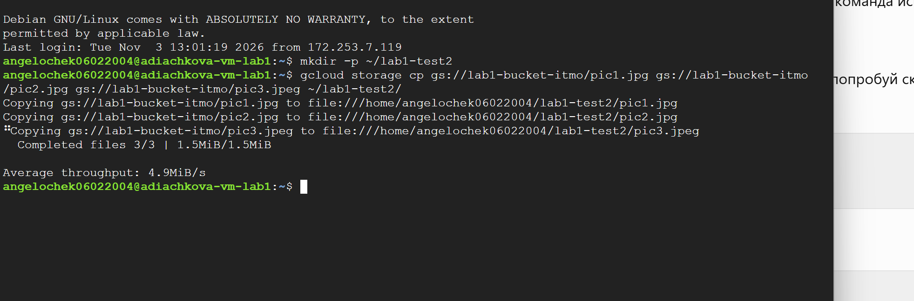

*Рисунок 11 — Повторное копирование после смены роли.*

### 5. Проверка публичного доступа

Во вкладке **Permissions** бакета указано наличие разрешений для публичных участников. Интерфейс также сообщает, что для проверки ограничений политики организации требуются дополнительные права.

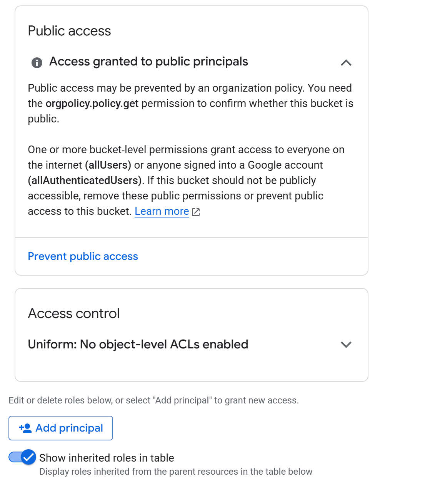

*Рисунок 12 — Информация о разрешениях публичного доступа к бакету.*

Для проверки файла `pic1.jpg` без авторизации выполнен запрос:

```bash
curl -s -o /dev/null -w "%{http_code}\n" https://storage.googleapis.com/lab1-bucket-itmo/pic1.jpg
```

Получен ответ **HTTP 200**. Это подтверждает, что данный файл доступен без авторизации и объясняет, почему доступ к нему не исчез после изменения роли сервисного аккаунта. Два других файла после смены роли также скопировались, но отдельно без авторизации не проверялись. Следовательно, успешное копирование само по себе не доказывает, что роль Compute Viewer предоставляет доступ к Cloud Storage.

### 6. Удаление созданных ресурсов

После эксперимента удалена виртуальная машина `adiachkova-vm-lab1`. В окне подтверждения было указано, что вместе с машиной удаляется её загрузочный диск.

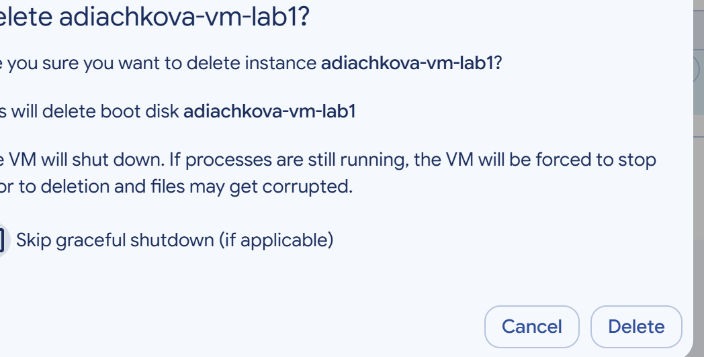

*Рисунок 13 — Окно подтверждения удаления виртуальной машины и загрузочного диска.*

Также удалён созданный сервисный аккаунт `adiachkova-sa-lab1`.

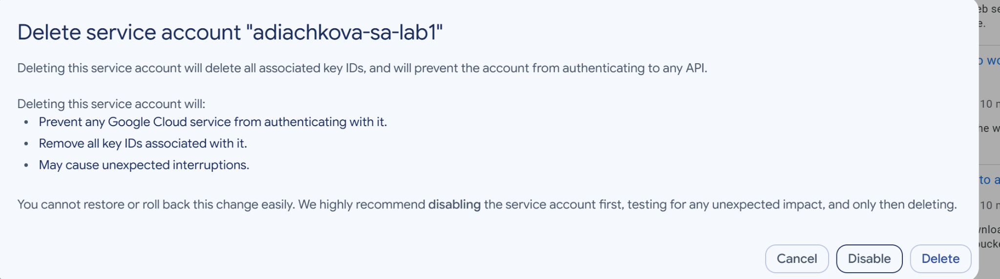

*Рисунок 14 — Окно подтверждения удаления сервисного аккаунта.*

Общий учебный бакет и его настройки не изменялись. Изображения выше показывают окна подтверждения удаления; для подтверждения отсутствия ресурсов после удаления могут быть добавлены скриншоты списков.

## Вывод

В ходе лабораторной работы был создан сервисный аккаунт с ролью Storage Admin и запущена виртуальная машина e2-micro в режиме Spot. Через SSH и Google Cloud CLI выполнено копирование трёх файлов из Cloud Storage; их наличие на виртуальной машине проверено командой `ls -lah`.

После замены роли на Compute Viewer повторное копирование осталось успешным. Анонимный HTTP-запрос к файлу `pic1.jpg` вернул код 200, подтвердив публичную доступность этого файла. Для отдельной проверки запрета доступа потребовался бы непубличный объект без других предоставленных разрешений. Созданные для работы виртуальная машина и сервисный аккаунт удалены.

## Источники

1. [ИТМО — лабораторная работа № 1](https://ex-itmo-ict-faculty.github.io/cloud-platforms-as-the-basis-of-technology-entrepreneurship/education/labs2023-2024/lab1/lab1/).
2. [ИТМО — правила оформления отчёта](https://ex-itmo-ict-faculty.github.io/cloud-platforms-as-the-basis-of-technology-entrepreneurship/education/labs2023-2024/reportdesign/).
3. [Google Cloud — сервисные аккаунты Compute Engine](https://docs.cloud.google.com/compute/docs/access/service-accounts).
4. [Google Cloud — роли IAM для Cloud Storage](https://docs.cloud.google.com/storage/docs/access-control/iam-roles).
5. [Google Cloud — виртуальные машины Spot](https://docs.cloud.google.com/compute/docs/instances/spot).
