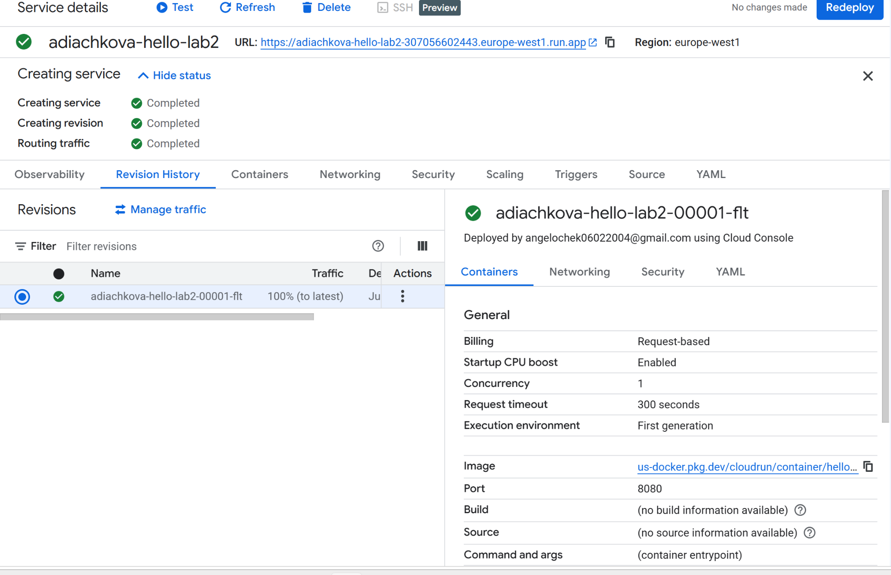
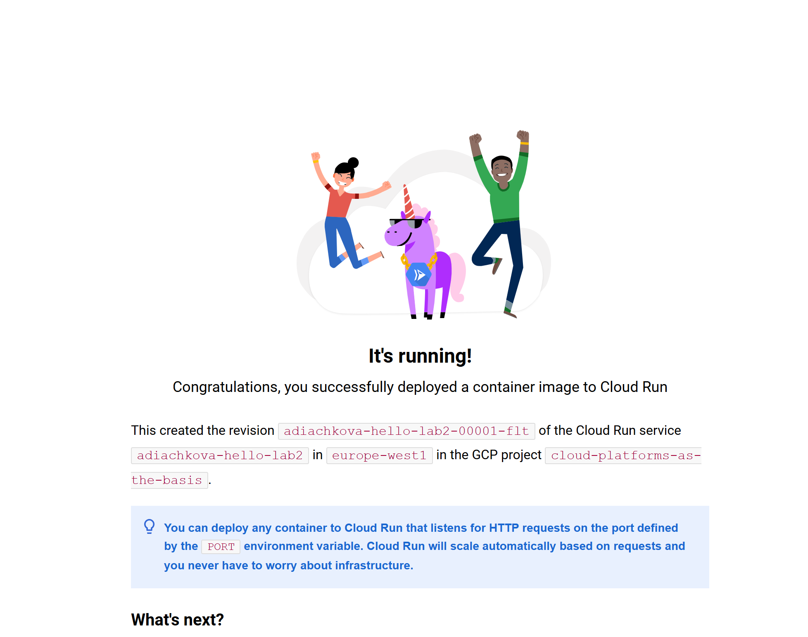
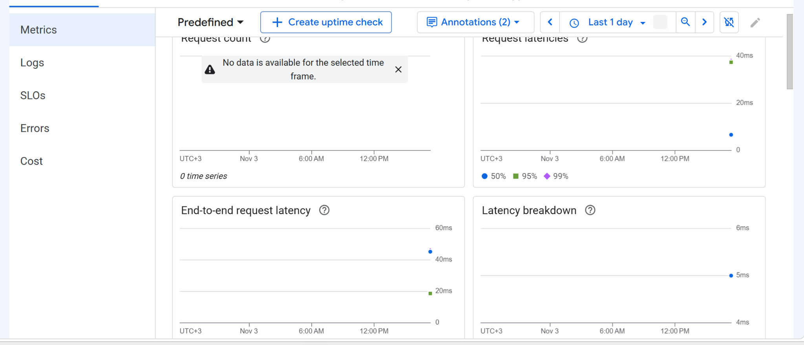
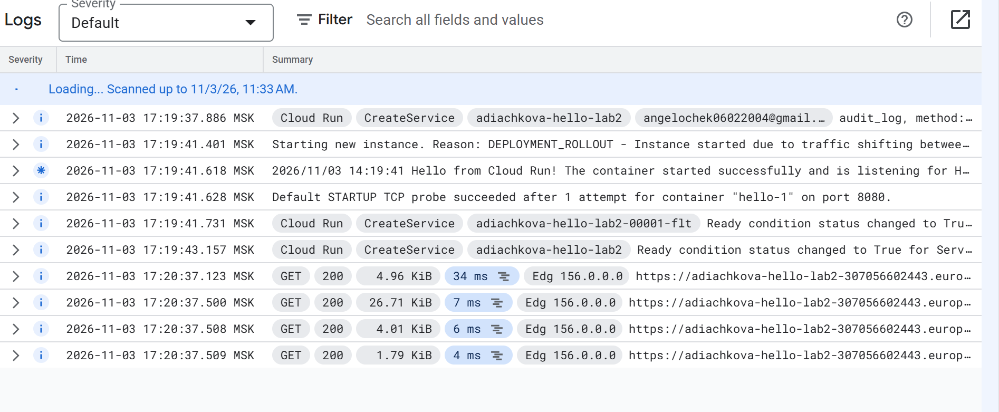
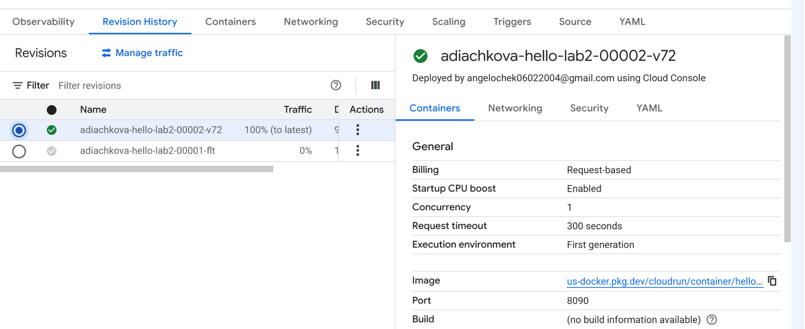
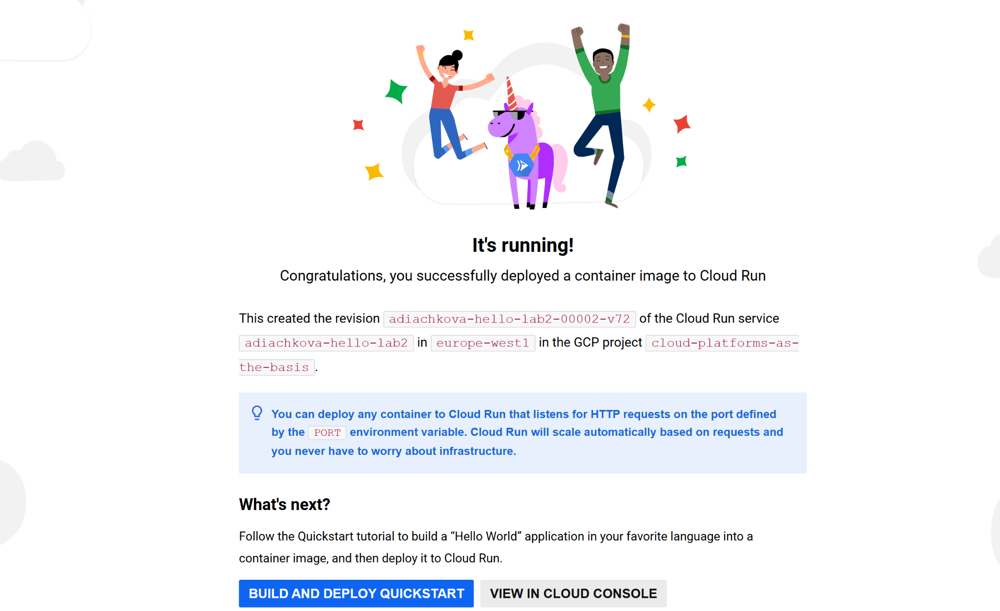
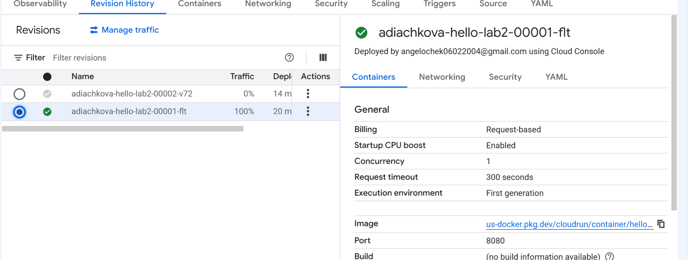
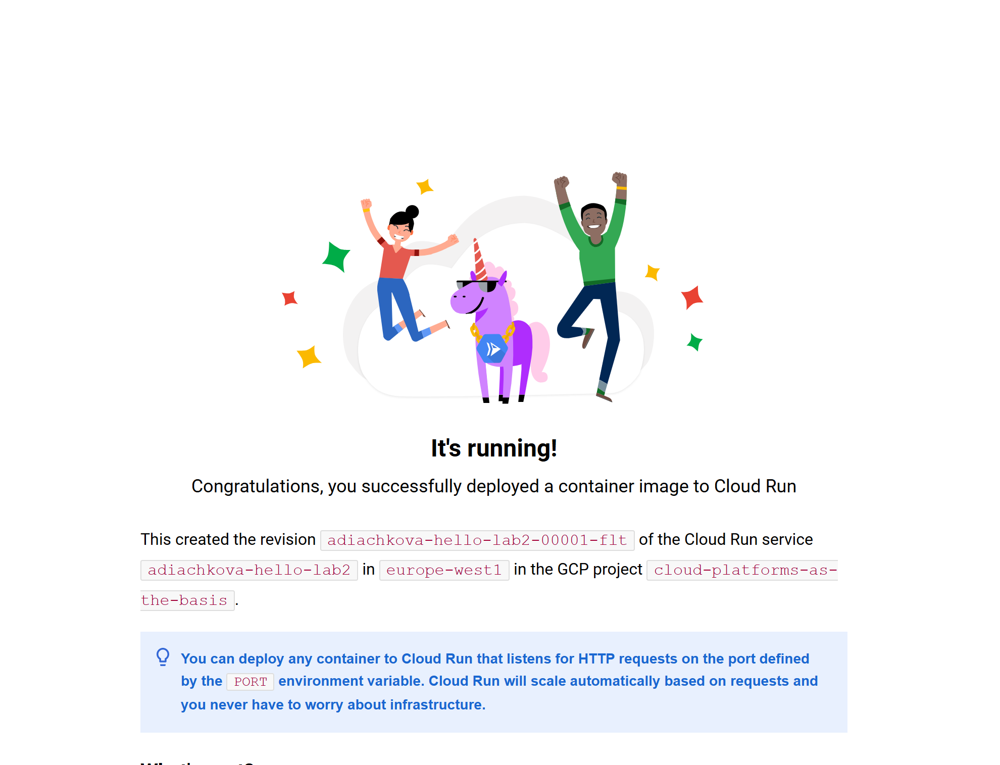
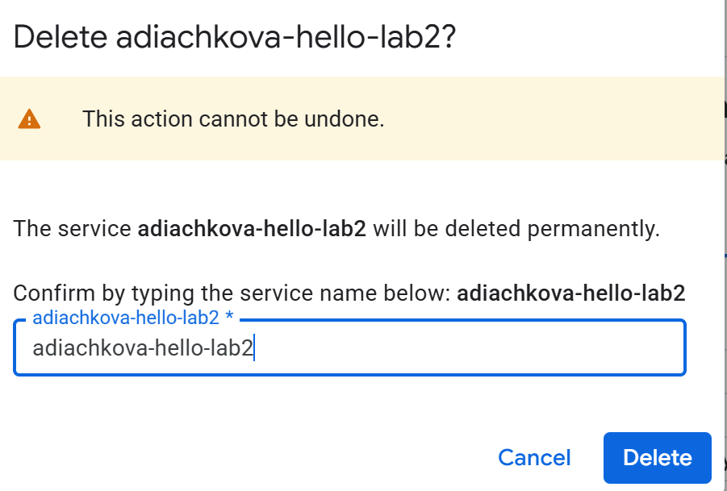

# Лабораторная работа № 2. Google Cloud Run

**Студент:** Дьячкова А.  
**Проект:** `cloud-platforms-as-the-basis`  
**Регион:** `europe-west1`  
**Сервис:** `adiachkova-hello-lab2`

## Цель работы

Освоить развёртывание контейнера в Google Cloud Run, изучить журналы и метрики сервиса, изменение параметров ревизии и управление трафиком.

## Ход работы

### 1. Создание сервиса

В Google Cloud Run создан сервис `adiachkova-hello-lab2` на основе тестового образа `us-docker.pkg.dev/cloudrun/container/hello`. Выбран публичный доступ, оплата по запросам и автоматическое масштабирование от 0 до 1 экземпляра. Для контейнера установлены 128 MiB памяти, 0,08 vCPU, среда исполнения первого поколения и не более одного одновременного запроса на экземпляр. Начальный порт контейнера — 8080.

Сервис и первая ревизия успешно созданы:

При переходе по адресу сервиса открылась тестовая страница **It's running!**. На ней указана первая ревизия `adiachkova-hello-lab2-00001-flt`.

### 2. Просмотр метрик и журналов

В разделе **Observability → Metrics** изучены графики, в том числе показатели задержки запросов. На момент создания снимка на графике количества запросов данные ещё не отображались.

В разделе **Logs** отображались записи о запуске контейнера и успешном прохождении проверки порта 8080. Запросы к странице получили HTTP-статус **200**.

### 3. Изменение порта контейнера

В настройках контейнера порт изменён с **8080** на **8090**, после чего сервис развёрнут повторно. Создана вторая ревизия `adiachkova-hello-lab2-00002-v72`.

После изменения порта тестовая страница продолжила открываться и показала имя второй ревизии.

Cloud Run передаёт контейнеру выбранный порт через переменную окружения `PORT`; тестовое приложение принимает запросы на указанном порту.

### 4. Переключение трафика

Через **Revision History → Manage traffic** весь трафик перенаправлен со второй ревизии на первую. В истории ревизий для первой указано 100% трафика, для второй — 0%.

После обновления страницы приложения снова отобразилась первая ревизия. Это подтвердило переключение трафика.

### 5. Удаление сервиса

После выполнения практической части сервис `adiachkova-hello-lab2` удалён. Перед удалением открыто окно подтверждения с названием сервиса.

*На скриншоте показано окно перед нажатием Delete. Удаление подтверждено после выполнения, но отдельный скриншот сообщения об успешном удалении не представлен.*

## Вывод

В ходе работы был развёрнут тестовый контейнер в Google Cloud Run. Проверена доступность приложения, изучены метрики и журналы, создана новая ревизия с портом 8090 и проверено переключение трафика на первую ревизию. После завершения работы сервис был удалён.

[Задание к лабораторной работе № 2](https://ex-itmo-ict-faculty.github.io/cloud-platforms-as-the-basis-of-technology-entrepreneurship/education/labs2023-2024/lab2/lab2/)
