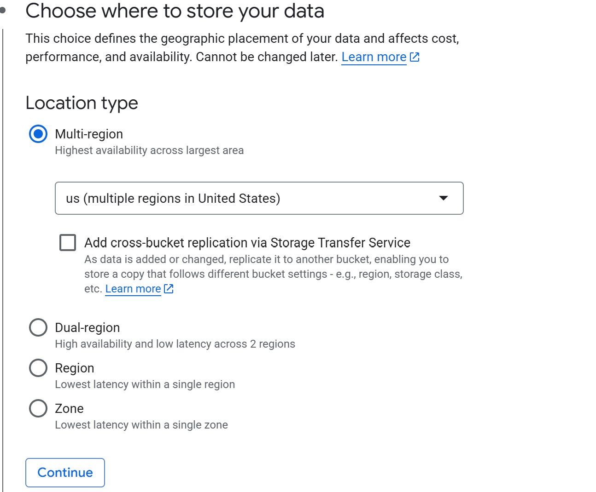
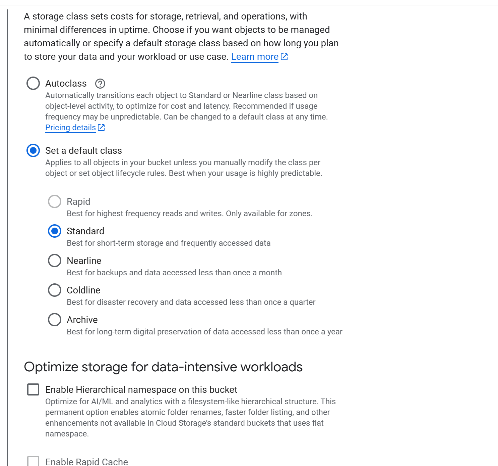
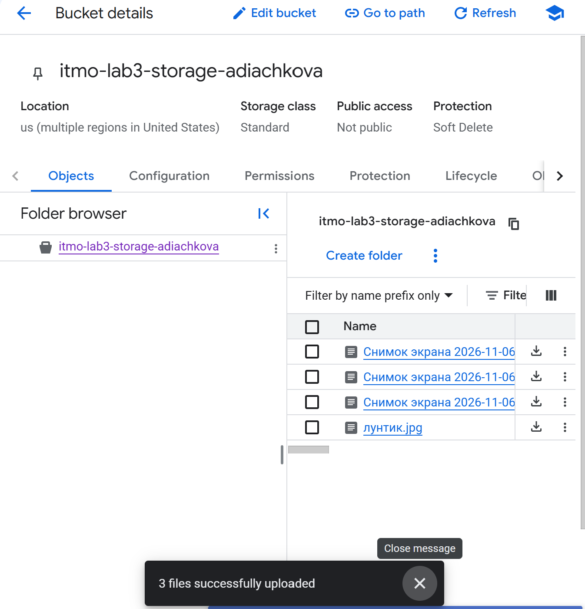
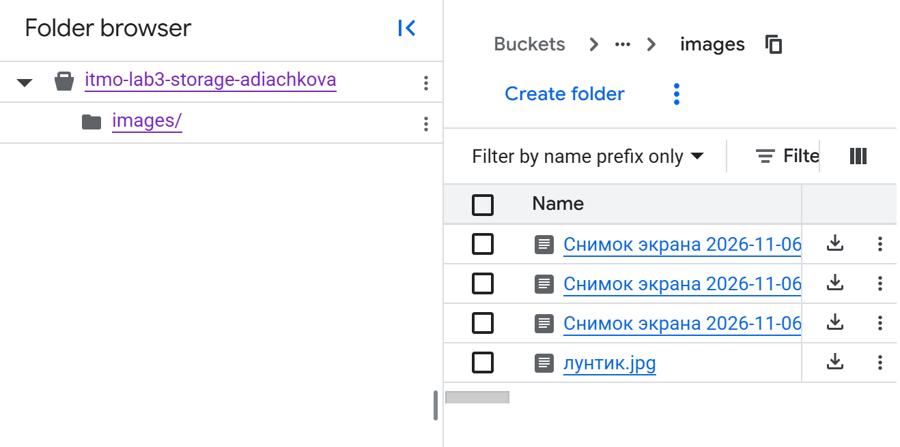
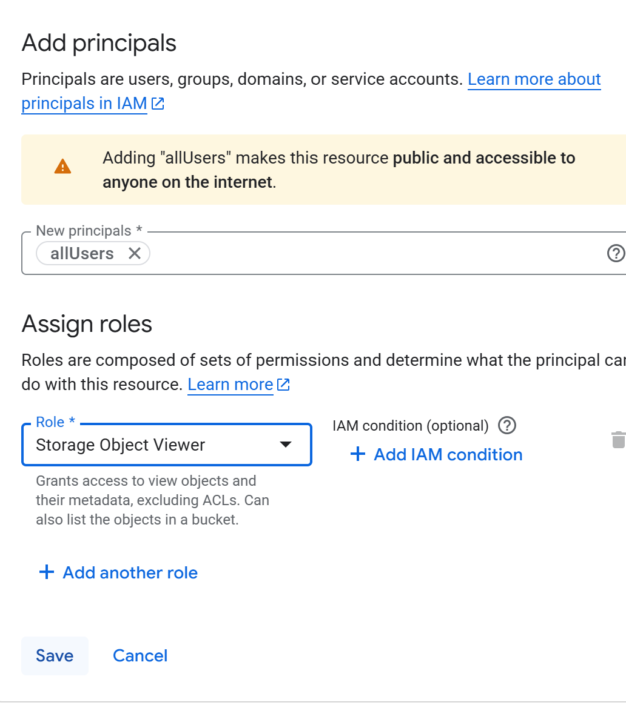
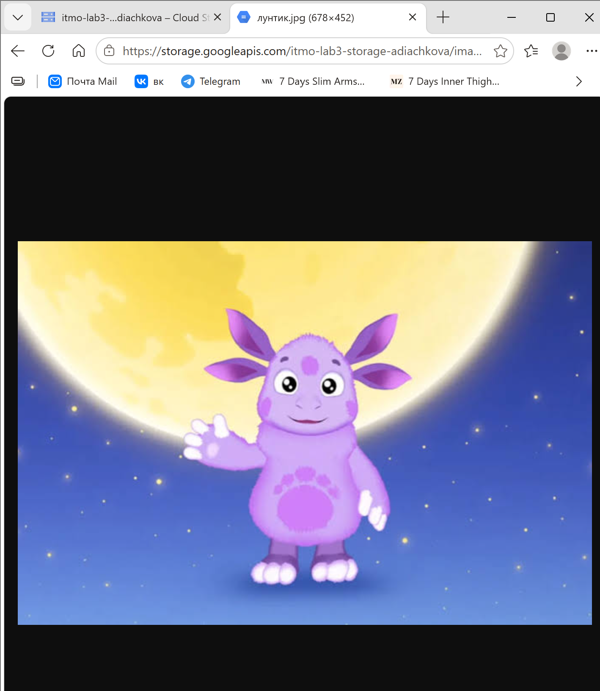

# Лабораторная работа № 3. Исследование Cloud Storage

**Университет:** ИТМО  
**Факультет:** ФТМИ  
**Дисциплина:** Облачные платформы как основа технологического предпринимательства  
**Учебный год:** 2026/2027  
**Автор:** Дьячкова Ангелина  
**Лабораторная работа:** № 3  
**Бакет:** `itmo-lab3-storage-adiachkova`

## Цель работы

Познакомиться с облачным хранилищем Google Cloud Storage и освоить создание бакета, загрузку и организацию файлов, а также настройку доступа к ним.

## Задачи

1. Выбрать существующий проект и создать бакет Cloud Storage.
2. Загрузить несколько изображений и переместить их в папку внутри бакета.
3. Настроить публичный доступ и получить ссылки на файлы.
4. Проверить открытие изображения и удалить созданный бакет.

## Ход работы

### 1. Создание бакета

В существующем проекте Google Cloud был создан бакет `itmo-lab3-storage-adiachkova`. Для размещения данных выбран тип **Multi-region** и расположение **us**.

*Рисунок 1 — Выбор расположения бакета.*

Для файлов выбран стандартный класс хранения **Standard**. Иерархическое пространство имён не включалось.

*Рисунок 2 — Выбор стандартного класса хранения.*

Для последующей настройки публичного доступа было отключено предотвращение публичного доступа на уровне бакета. В качестве способа управления доступом выбран режим **Uniform**.

### 2. Загрузка изображений

В созданный бакет были загружены четыре изображения. На странице **Objects** отображается список загруженных файлов.

*Рисунок 3 — Изображения в бакете.*

### 3. Создание папки и перемещение файлов

В бакете создана папка `images`. Все четыре изображения перемещены в неё; после открытия папки файлы отображаются в списке объектов.

*Рисунок 4 — Содержимое папки images.*

### 4. Настройка доступа и проверка ссылки

В разделе **Permissions** для участника `allUsers` выбрана роль **Storage Object Viewer**. Эта роль позволяет всем пользователям интернета просматривать объекты и их метаданные, а также получать список объектов в бакете.

*Рисунок 5 — Выбор участника и роли для публичного доступа.*

Через интерфейс объекта получена ссылка на изображение. При открытии ссылки в браузере отобразился файл `лунтик.jpg`.

*Рисунок 6 — Изображение, открытое по ссылке Cloud Storage.*

На скриншоте показана проверка в обычном окне браузера; отдельный скриншот проверки без входа в аккаунт не представлен.

### 5. Удаление бакета

После выполнения практической части бакет был удалён. Отдельный скриншот результата удаления не представлен. При создании бакета была включена политика **Soft Delete** со сроком по умолчанию, поэтому удалённые данные временно сохраняются для возможного восстановления.

## Вывод

В ходе лабораторной работы был создан бакет Google Cloud Storage, в него загружены четыре изображения и перемещены в папку. Настроен доступ к объектам для `allUsers`, получена ссылка и проверено открытие изображения в браузере. После завершения работы бакет удалён.

## Источники

1. [ИТМО — лабораторная работа № 3](https://ex-itmo-ict-faculty.github.io/cloud-platforms-as-the-basis-of-technology-entrepreneurship/education/labs2023-2024/lab3/lab3/)
