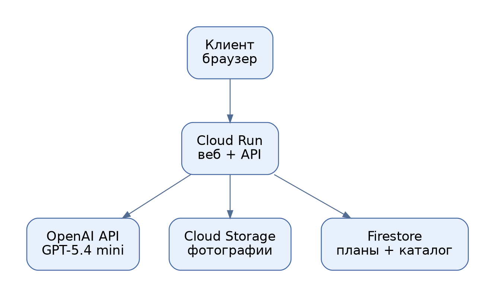
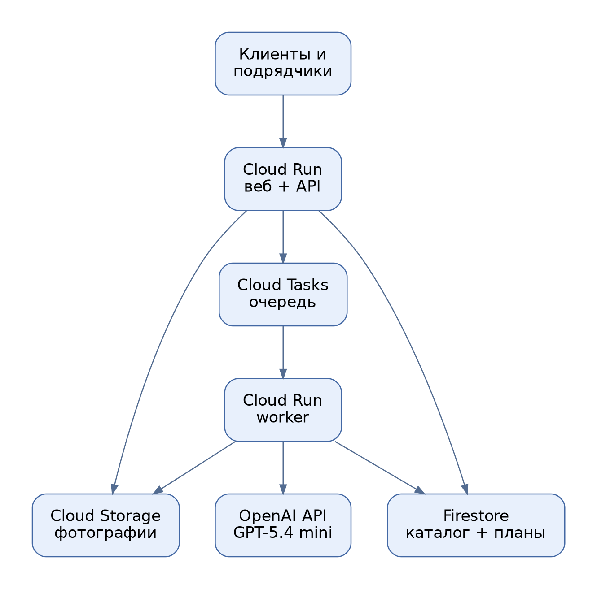
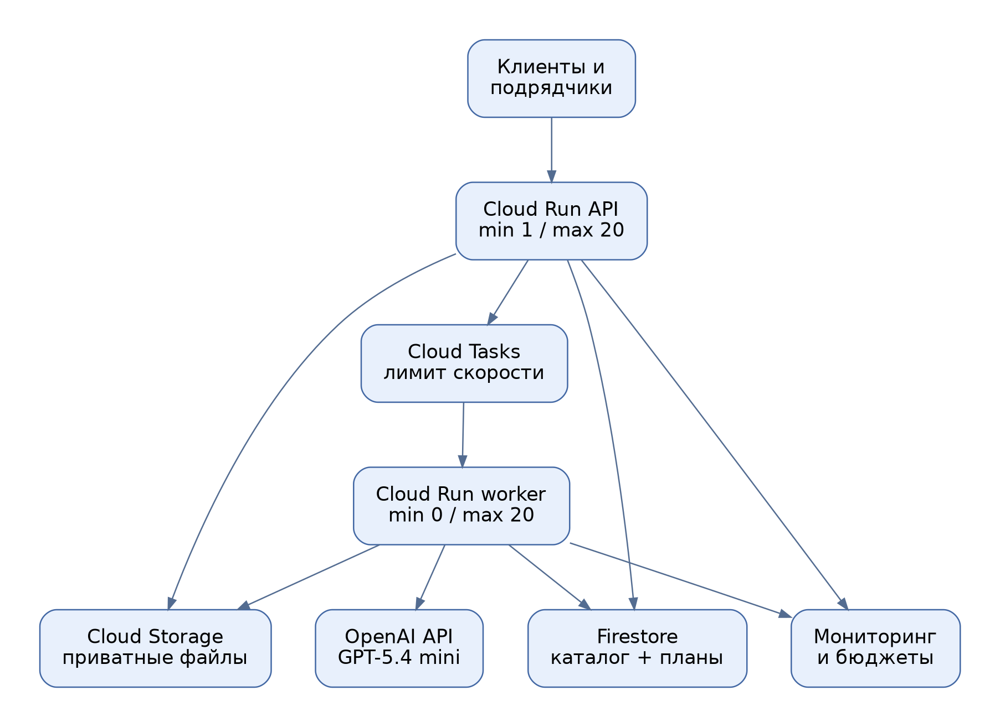

# Лабораторная работа № 4. Разработка инфраструктуры MVP AI-приложения

**Университет:** ИТМО  
**Факультет:** ФТМИ  
**Дисциплина:** Облачные платформы как основа технологического предпринимательства  
**Учебный год:** 2026/2027  
**Автор:** Дьячкова Ангелина  
**Лабораторная работа:** № 4  


## Цель работы

Разработать схему облачной инфраструктуры для AI-платформы Svadly, подобрать необходимые сервисы и рассчитать примерные расходы на их использование на разных этапах развития проекта.

## Задачи работы

1. Описать приложение и определить, какие сервисы могут понадобиться для его работы.
2. Создать схемы для начального этапа, тестирования партнёрами и полноценного запуска.
3. Объяснить выбор облачных сервисов.
4. Оценить расходы на каждом этапе и сравнить результаты.

## 1. Описание проекта

Для лабораторной работы была выбрана платформа Svadly (проект с ппм итмо). С её помощью можно получить примерную смету свадьбы по фотографиям-референсам. Пользователь загружает изображения оформления, а сайт предлагает оценку стоимости по отдельным статьям расходов. Также на сайте есть каталог свадебных подрядчиков.

В работе предложен учебный вариант того, как может быть устроена инфраструктура такого приложения. Для анализа фотографий и подготовки текста сметы выбрана модель GPT-5.4 mini через OpenAI API. 

На схемах и в расчётах показан проект инфраструктуры.

## 2. Исходные данные для расчёта

Чтобы сравнить расходы на разных этапах, были приняты следующие условия:

| Показатель за месяц | Начальный этап | Тестирование партнёрами | Полноценный запуск |
|---|---:|---:|---:|
| Количество активных пользователей | 100 | 1 000 | 10 000 |
| Количество смет на одного пользователя | 5 | 5 | 5 |
| Всего созданных смет | 500 | 5 000 | 50 000 |
| Обращения к AI с учётом повторов | 550 | 5 500 | 55 000 |
| Объём фотографий в хранилище, GiB | 5 | 30 | 300 |
| Объём базы данных, GiB | 1 | 5 | 30 |
| Исходящий трафик за месяц, GiB | 5 | 40 | 400 |

Количество пользователей, смет, фотографий и другие показатели были предложены с помощью искусственного интеллекта для учебного расчёта. Суммы расходов также рассчитаны с помощью ИИ по этим условным данным и выбранным тарифам. Это не фактические показатели и не реальные расходы Svadly.

Предполагается, что пользователь создаёт в среднем пять смет в месяц. Например, на начальном этапе 100 пользователей создадут `100 × 5 = 500` смет. К количеству обращений к AI добавлено 10% на возможные повторы запросов при ошибках: `500 × 1,1 = 550` обращений.

Для расчёта принято, что на одну смету приходится в среднем 2–3 фотографии. Фактическая стоимость обработки зависит от количества и размера изображений, объёма ответа и числа повторных обращений.

## 3. Схемы инфраструктуры

Схемы подготовлены в draw.io для трёх этапов развития проекта. Их можно открыть и изменить в [diagrams.net](https://app.diagrams.net/): [файл со схемами](diagrams/wedding_architecture.drawio).

### 3.1. Начальный этап



*Рисунок 1 — Инфраструктура на начальном этапе.*

На первом этапе предполагается небольшое количество пользователей. Для работы приложения используется один сервис **Cloud Run**. Он принимает запросы с сайта и обращается к AI-модели. Фотографии сохраняются в **Cloud Storage**, а данные о сметах и подрядчиках — в **Firestore**.

Для Cloud Run выбран минимум работающих экземпляров, равный нулю. Это значит, что при отсутствии запросов приложение может не держать экземпляр запущенным. Когда появится новый запрос, сервис запустит его снова. Из-за этого первый ответ может занять больше времени.

### 3.2. Тестирование партнёрами



*Рисунок 2 — Инфраструктура на этапе тестирования партнёрами.*

На втором этапе пользователей и запросов становится больше. Поэтому к схеме добавляются **Cloud Tasks** и отдельный обработчик — **worker**.

Cloud Tasks создаёт очередь запросов. Worker получает задачу из очереди, передаёт фотографии модели OpenAI и сохраняет готовую смету. Очередь помогает управлять количеством задач, которые обрабатываются одновременно, и повторять запросы при некоторых временных ошибках. Повторный вызов AI может оплачиваться отдельно.

### 3.3. Полноценный запуск



*Рисунок 3 — Инфраструктура для полноценной работы приложения.*

На третьем этапе предполагается, что приложением пользуется ещё больше людей. Сервис, принимающий запросы, и обработчик смет могут увеличивать число работающих экземпляров независимо друг от друга. Это позволяет добавлять ресурсы для той части приложения, на которую приходится большая нагрузка.

Для сервиса, принимающего запросы, предусмотрен минимум один работающий экземпляр. Это помогает уменьшить задержку при его запуске. Для контроля работы предлагается использовать **Cloud Monitoring** и уведомления о расходах в Google Cloud Billing. Уведомление о бюджете само по себе не останавливает расходы.

## 4. Выбранные сервисы

| Сервис | Для чего используется в проекте |
|---|---|
| **Cloud Run** | Запускает приложение и обрабатывает запросы пользователей. |
| **OpenAI API / GPT-5.4 mini** | Помогает анализировать фотографии и формировать текст сметы. |
| **Cloud Storage** | Хранит загруженные пользователями фотографии. |
| **Firestore** | Хранит данные о сметах, задачах и подрядчиках. |
| **Cloud Tasks** | Создаёт очередь запросов на обработку. |
| **Cloud Monitoring и Billing** | Помогают следить за работой приложения и расходами. |

Эти сервисы выбраны потому, что они решают разные задачи. Cloud Storage нужен для файлов, Firestore — для информации о сметах и подрядчиках, а Cloud Run — для работы программы. Очередь и отдельный обработчик предлагается добавить, когда число запросов вырастет.

Фотографии пользователей в предложенной схеме хранятся в закрытом бакете. Для доступа к смете без регистрации можно использовать специальную ссылку. Поскольку любой человек с такой ссылкой сможет открыть результат, необходимо продумать срок её действия и правила передачи. Доступ к управлению каталогом подрядчиков должен быть ограничен.

## 5. Экономическая модель

Расходы рассчитаны за один месяц в долларах США. Для оценки использованы условные показатели из раздела 2 и тарифы сервисов, указанные в источниках. Расчёт подготовлен с помощью ИИ и представлен в [таблице Excel](svadly_costs.xlsx). В таблице можно изменить исходные значения и пересчитать итог.

Для AI принято, что на одно обращение потребуется 5 000 входных токенов, включая обработку изображений, и 1 800 выходных токенов. **Токены** — единицы, в которых учитывается объём информации, обрабатываемой AI-моделью. В расчёте используется ставка GPT-5.4 mini: $0,75 за 1 млн входных токенов и $4,50 за 1 млн выходных токенов.

Пример стоимости одного обращения к AI:

```text
(5 000 × $0,75 + 1 800 × $4,50) / 1 000 000 = $0,01185
```

На начальном этапе с учётом повторов предполагается 550 обращений:

```text
550 × $0,01185 = $6,52 в месяц после округления
```

В итоговую таблицу также включены расходы на запуск приложения, хранение данных и интернет-трафик. Для небольших служебных расходов добавлен условный резерв $2, $5 и $20 на трёх этапах соответственно. Сверх полученной суммы заложено ещё 20% на возможные отклонения.

| Расходы, $ в месяц | Начальный этап | Тестирование партнёрами | Полноценный запуск |
|---|---:|---:|---:|
| AI: анализ текста и изображений | $6,52 | $65,17 | $651,75 |
| Cloud Run: работа приложения | $0,14 | $1,39 | $13,95 |
| Cloud Run: резерв на постоянно работающий экземпляр | $0,00 | $0,00 | $9,72 |
| Cloud Storage | $0,10 | $0,63 | $6,27 |
| Firestore | $0,15 | $0,78 | $4,75 |
| Исходящий интернет-трафик | $0,60 | $4,80 | $48,00 |
| Cloud Tasks | $0,00 | $0,00 | $0,00 |
| Условный служебный резерв | $2,00 | $5,00 | $20,00 |
| Всего до резерва 20% | $9,51 | $77,77 | $754,44 |
| **Всего с резервом 20%** | **$11,41** | **$93,33** | **$905,33** |

Расходы на Cloud Tasks в выбранном сценарии остаются в пределах учтённой бесплатной квоты. Бесплатные квоты Cloud Run и Firestore в расчёте не вычитались. Стоимость OpenAI API учитывается отдельно от оплаты Google Cloud и не входит в подписку ChatGPT.

Это приблизительная оценка: фактические расходы будут зависеть от количества пользователей, фотографий, запросов и времени их обработки. В сумму не включены, например, зарплаты разработчиков, домен, некоторые расходы на резервное копирование, налоги и возможная плата за передачу данных из Google Cloud в OpenAI. Поэтому сумма не отражает полную стоимость ведения проекта.

## 6. Сравнение этапов

На начальном этапе выбрана более простая схема: один сервис принимает запросы и работает с AI. Это удобно для проверки идеи при небольшом количестве пользователей.

Во время тестирования партнёрами добавляются очередь и обработчик. Они помогают распределять задачи, когда запросов становится больше.

При полноценном запуске разные части приложения можно масштабировать отдельно. Также необходимо следить за ошибками, скоростью обработки и расходами. Перед использованием предложенной схемы нужно проверить её работу под реальной нагрузкой и уточнить квоты сервисов.

## Вывод

В ходе лабораторной работы была предложена инфраструктура AI-платформы Svadly для трёх этапов развития. Были подготовлены схемы, выбраны сервисы для работы приложения, хранения данных и обработки фотографий, а также рассчитаны примерные расходы.

Расчёт показал, что при увеличении числа пользователей и запросов расходы на инфраструктуру растут. Наибольшая статья в предложенной модели — обращения к AI. Исходные данные и суммы были подготовлены с помощью ИИ и требуют проверки на реальных показателях проекта.

## Источники

1. [Сайт проекта Svadly](https://svadly.ru/).
2. [Задание лабораторной работы № 4](https://ex-itmo-ict-faculty.github.io/cloud-platforms-as-the-basis-of-technology-entrepreneurship/education/labs2023-2024/lab4/lab4/).
3. [Тарифы OpenAI API — GPT-5.4 mini](https://developers.openai.com/api/docs/models/gpt-5.4-mini).
4. [Тарифы Cloud Run](https://cloud.google.com/run/pricing).
5. [Тарифы Cloud Storage](https://cloud.google.com/storage/pricing).
6. [Тарифы Firestore](https://cloud.google.com/firestore/pricing).
7. [Тарифы Cloud Tasks](https://cloud.google.com/tasks/pricing).
8. [Тарифы сетевого трафика](https://cloud.google.com/vpc/network-pricing).
