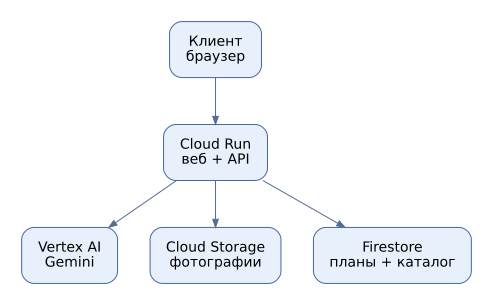
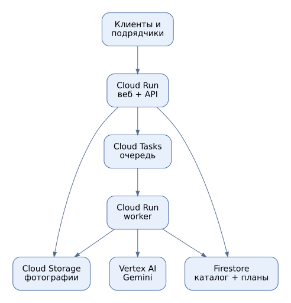
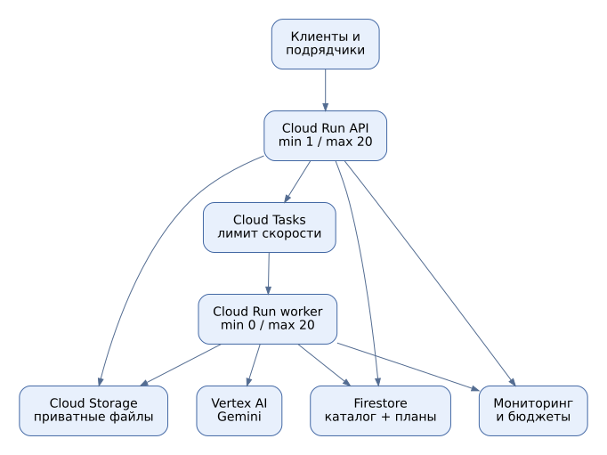

# Лабораторная работа № 4. Разработка инфраструктуры MVP AI-приложения

**Университет:** ИТМО  
**Факультет:** ФТМИ  
**Дисциплина:** Облачные платформы как основа технологического предпринимательства  
**Учебный год:** 2026/2027  
**Автор:** Дьячкова Ангелина  
**Лабораторная работа:** № 4  

## Цель работы

Спроектировать инфраструктуру AI-платформы Svadly для планирования свадеб на трёх этапах развития, обосновать выбор облачных сервисов и оценить расходы на их содержание.

## Задачи

1. Описать приложение и допущения о нагрузке.
2. Подготовить схемы начальной версии, партнёрского тестирования и промышленного запуска в draw.io.
3. Выбрать облачные сервисы и объяснить, как они взаимодействуют.
4. Рассчитать ориентировочные ежемесячные расходы и сравнить этапы.

Работа проектная: ниже предлагается учебная архитектура для Svadly; она не описывает подтверждённый технический стек действующего сайта. Облачные ресурсы в рамках лабораторной не создавались, нагрузочные испытания не выполнялись. Все показатели ниже — учебные допущения, а не фактические данные проекта.

## 1. Описание приложения

[Svadly](https://svadly.ru/) помогает оценить стоимость свадьбы по фотографиям-референсам. На сайте предлагается загрузить до 20 изображений без узнаваемых лиц и получить бесплатную смету без регистрации. На главной странице указано ориентировочное время расчёта около минуты; результат включает диапазон стоимости, отдельные статьи расходов и идеи экономии. Сметой можно поделиться по ссылке. На сайте также есть каталог подрядчиков Петербурга и Москвы, квиз и статьи; цены в каталоге, согласно сайту, указывают подрядчики.

В учебной архитектуре сервис использует мультимодальную AI-модель для анализа изображений и сопоставляет результат с каталогом и ценовыми ориентирами. Этот вариант является предложением для лабораторной: модель, способ хранения, фактическое число пользователей и реализованная серверная логика сайта неизвестны. Смета ориентировочная, цены и доступность следует уточнять у подрядчиков. Полноценное бронирование, платежи, комиссии, платное продвижение и генерация новых изображений в расчёт не включены.

## 2. Допущения о нагрузке

| Показатель в месяц | Начало | Партнёры | Продакшен |
|---|---:|---:|---:|
| Активных пользователей | 100 | 1 000 | 10 000 |
| Планов на пользователя | 5 | 5 | 5 |
| Сформированных планов | 500 | 5 000 | 50 000 |
| Среднее число оплачиваемых AI-вызовов с повторами | 550 | 5 500 | 55 000 |
| Входных токенов на AI-вызов, включая изображения | 5 000 | 5 000 | 5 000 |
| Выходных токенов, включая reasoning | 1 800 | 1 800 | 1 800 |
| Среднее время Cloud Run на AI-вызов — проектное допущение | 10 с | 10 с | 10 с |
| Фото в Cloud Storage, GiB | 5 | 30 | 300 |
| Firestore с индексами, GiB | 1 | 5 | 30 |
| Исходящий интернет-трафик, GiB | 5 | 40 | 400 |

Один план — одна сформированная смета. Для модели расчёта предполагаются в среднем 2–3 фотографии на смету, хотя интерфейс сайта допускает до 20; в пересчёте на токены количество и разрешение изображений существенно влияют на стоимость. Каждый план — один запрос пользователя. Для бюджета добавлено 10% оплачиваемых повторов: фактическая доля и длина запросов могут отличаться. Для оценки Firestore принято 8 чтений и 3 записи на план; для Cloud Storage — одна операция класса A и одна класса B. Ограничение изображений, их разрешение и количество на запрос должны проверяться приложением: изображения расходуют токены, и точное число зависит от модели и параметров обработки.

## 3. Схемы инфраструктуры

[Редактируемый файл draw.io](diagrams/wedding_architecture.drawio) содержит три страницы. Его можно открыть на [diagrams.net](https://app.diagrams.net/) через **File → Open from → Device**. Ниже — изображения схем; они показывают проект, а не работающие облачные ресурсы.

### 3.1. Начальный этап

*Рисунок 1 — Начальный вариант инфраструктуры.*

Один сервис **Cloud Run** обслуживает интерфейс и запросы, обращается к AI, сохраняет фотографии в приватном **Cloud Storage**, а планы и каталог — в **Firestore**. Minimum instances = 0: при отсутствии запросов сервис может масштабироваться до нуля. Небольшой задержкой холодного старта можно пожертвовать на учебном MVP. Указанные на сайте около минуты относятся к пользовательскому ожиданию, тогда как 10 секунд в смете — отдельное условное допущение об оплачиваемом времени Cloud Run, требующее измерений. Условные параметры: 1 vCPU, 512 MiB, max 2 экземпляра.

### 3.2. Тестирование партнёрами

*Рисунок 2 — API, очередь и отдельный обработчик.*

При росте числа пользователей AI-обработка отделяется от API. API создаёт задачу в **Cloud Tasks** и возвращает её идентификатор. Очередь передаёт задачу отдельному **Cloud Run worker**, который получает фото из Storage, вызывает AI и сохраняет результат в Firestore. Интерфейс запрашивает статус. Очередь ограничивает скорость и повторяет временно неуспешные задачи. В ней передаётся идентификатор, а не само фото.

Предполагаются min 0 и max 5 экземпляров для каждого сервиса; эти значения требуют проверки нагрузочным тестом. Для повторов нужны идентификатор задачи и проверка статуса; вызов AI после сбоя всё равно может повторно тарифицироваться.

### 3.3. Промышленный запуск

*Рисунок 3 — Независимое масштабирование компонентов.*

API и worker масштабируются независимо: для API предполагается min 1, max 20; для worker — min 0, max 20. **Cloud Monitoring и Billing Budgets** помогают следить за ошибками, очередью и расходами. Уведомление о бюджете не является гарантией автоматической остановки расходов. Хранилище и база остаются теми же, что уменьшает объём изменений при росте нагрузки.

Проверка мощности перед запуском обязательна: в среднем 50 000 планов за 30 дней — около 0,019 задания в секунду. Если условный пик в 50 раз выше среднего, получится около 0,96 задания/с. При 10 секундах на обработку это около 10 одновременных заданий; ограничение очереди, настройки concurrency и квоты AI проверяются отдельно. Это проектная оценка, а не результат теста.

## 4. Выбор сервисов и безопасность

| Сервис | Назначение и причина выбора |
|---|---|
| Cloud Run | Запуск контейнеров без управления виртуальными машинами и масштабирование по нагрузке. |
| Vertex AI / Gemini | Анализ текста и фотографий и формирование плана без самостоятельного содержания GPU. |
| Cloud Storage | Хранение фотографий; бакет закрыт от публичного доступа. |
| Firestore | Хранение пользователей, планов, статусов задач и каталога подрядчиков. |
| Cloud Tasks | Очередь, контроль скорости и повторов на этапах тестирования и запуска. |
| Cloud Monitoring и Billing | Наблюдение за ошибками, задержками, очередью и расходами. |

На сайте получение сметы предлагается без регистрации. В предлагаемой схеме публичный API ограничивает частоту запросов, выдаёт случайный непредсказуемый идентификатор ссылки на результат и хранит только минимум данных; доступ к самому объекту остаётся закрытым. Любой, у кого есть ссылка, сможет открыть смету, поэтому срок действия и передача ссылки требуют отдельного решения. Для редактирования каталога подрядчиков и администраторов предусматривается аутентификация и проверка прав. Загрузки ограничиваются по размеру и формату, доступ к фотографиям предоставляется только владельцу и уполномоченным сервисам. Сервисные аккаунты получают минимальные права; секреты и личные данные не включаются в логи. Global endpoint AI не гарантирует размещение обработки в конкретной стране: при требованиях к локализации необходимо отдельно проверить регион и пересчитать тариф.

## 5. Экономическая модель

Оценка выполнена в долларах США за 30-дневный месяц, без НДС, кредитов и скидок. Основные ресурсы для расчёта приняты в регионе **us-central1**, AI — через **global endpoint**. Ставки проверены по официальным страницам 6 ноября 2026 года; фактические цены и объём потребления могут отличаться. Бесплатные квоты для Cloud Run и Firestore не вычитаются, чтобы не зависеть от использования другими сервисами. Для Cloud Tasks учтена бесплатная квота 1 млн операций в месяц.

| Параметр | Ставка / допущение |
|---|---|
| Gemini 3.1 Flash-Lite, global, Standard | $0,25 / 1 млн входных и $1,50 / 1 млн выходных токенов |
| Cloud Run, активное время | $0,000024 / vCPU·с и $0,0000025 / GiB·с; $0,40 / 1 млн запросов |
| Cloud Run, резерв на min instance | $0,0000025 / vCPU·с и $0,0000025 / GiB·с в режиме простоя |
| Cloud Storage Standard | Около $0,02 / GiB·месяц; операции A — $0,005 и B — $0,0004 за 1 000 |
| Firestore Standard | $0,03 / 100 тыс. чтений, $0,09 / 100 тыс. записей; около $0,15 / GiB·месяц |
| Интернет-трафик | Плановый ориентир $0,12 / GiB; реальная ставка зависит от направления и объёма |
| Cloud Tasks | Первые 1 млн операций бесплатно, далее $0,40 / млн; оценка — 2 операции на план |

Для одного AI-вызова: `(5 000 × 0,25 + 1 800 × 1,50) / 1 000 000 = $0,00395`. Входные 5 000 токенов уже включают фото: отдельно стоимость изображения в расчёте не прибавляется.

Для Cloud Run: `AI-вызовы × 10 с × (0,000024 + 0,5 × 0,0000025) + 3 × планы × 0,40 / 1 000 000`. Это упрощённая консервативная оценка активного времени. Накладные операции и пересечения параллельных запросов фактически меняют счёт. На продакшене дополнительно заложен полный месяц простоя одной минимальной инстанции: `720 × 3 600 × (0,0000025 + 0,5 × 0,0000025) = $9,72`; активное время той же инстанции при этом может быть учтено дважды.

`Cloud Storage = GiB × $0,02 + планы × $0,0054 / 1 000`. `Firestore = GiB × $0,15 + планы × (8 × $0,03 + 3 × $0,09) / 100 000`. Для очереди принято два тарифицируемых действия на план; даже на продакшене это 100 000 действий, что ниже отдельной бесплатной квоты.

Для мелких служебных расходов предусмотрены условные $2 / $5 / $20 в месяц, а сверх суммы — общий резерв 20%. Это проектные допущения, а не опубликованные тарифы Google.

| Статья, $/мес. | MVP | Партнёры | Продакшен |
|---|---:|---:|---:|
| AI: текст и изображения | $2.17 | $21.73 | $217.25 |
| Cloud Run: активная работа | $0.14 | $1.39 | $13.95 |
| Cloud Run: запас min instance | $0.00 | $0.00 | $9.72 |
| Cloud Storage | $0.10 | $0.63 | $6.27 |
| Firestore | $0.15 | $0.78 | $4.75 |
| Исходящий трафик | $0.60 | $4.80 | $48.00 |
| Cloud Tasks | $0.00 | $0.00 | $0.00 |
| Служебный резерв | $2.00 | $5.00 | $20.00 |
| Итого без общего резерва | $5.17 | $34.32 | $319.94 |
| **Итого с резервом 20%** | $6.20 | $41.19 | $383.93 |

Подробные значения до округления представлены в [costs.csv](costs.csv). Оценка не включает полноценный staging, резервные копии/PITR, увеличенные объёмы логов, аутентификацию сверх бесплатных лимитов, домен, WAF, оплату разработчиков и поддержку. Стоимость хранения версий и восстановимых удалённых файлов зависит от политики хранения; она должна входить в измеряемый объём или рассчитываться отдельно. Служебный и общий резервы не гарантируют покрытия этих расходов.

При удвоении выходных токенов до 3 600 AI-статья на продакшене вырастет на `55 000 × 1 800 × $1,50 / 1 000 000 = $148,50` до резерва. Поэтому необходимы лимиты токенов, контроль количества повторов и мониторинг фактического использования. Смета не является полной себестоимостью продукта.

## 6. Почему инфраструктура меняется

На старте один сервис проще развернуть и поддерживать, а при отсутствии пользователей он может отключаться. Во время тестирования партнёрами очередь и отдельный обработчик позволяют управлять длительными AI-запросами и сглаживать нагрузку. В промышленной версии компоненты масштабируются независимо, появляется минимально работающий API и расширенный мониторинг. При каждом переходе требуется проверить квоты модели, ошибки и качество результата; для Cloud Run и AI увеличение числа экземпляров само по себе не увеличивает квоты AI.

## Вывод

Разработан проект инфраструктуры свадебной AI-платформы для трёх этапов. Подготовлены схемы в формате draw.io, обоснованы облачные сервисы и рассчитана ориентировочная стоимость их использования при заданной нагрузке. Для следующего этапа потребуется проверить фактические размеры изображений, количество токенов и производительность, а также уточнить стоимость исключённых сервисов.

## Источники

1. [Сайт проекта Svadly](https://svadly.ru/).
2. [Задание лабораторной работы № 4](https://ex-itmo-ict-faculty.github.io/cloud-platforms-as-the-basis-of-technology-entrepreneurship/education/labs2023-2024/lab4/lab4/).
2. [Тарифы Vertex AI / Gemini](https://cloud.google.com/model-garden/pricing).
3. [Тарифы Cloud Run](https://cloud.google.com/run/pricing).
4. [Тарифы Cloud Storage](https://cloud.google.com/storage/pricing).
5. [Тарифы Firestore](https://cloud.google.com/firestore/pricing).
6. [Тарифы Cloud Tasks](https://cloud.google.com/tasks/pricing).
7. [Тарифы сетевого трафика](https://cloud.google.com/vpc/network-pricing).
